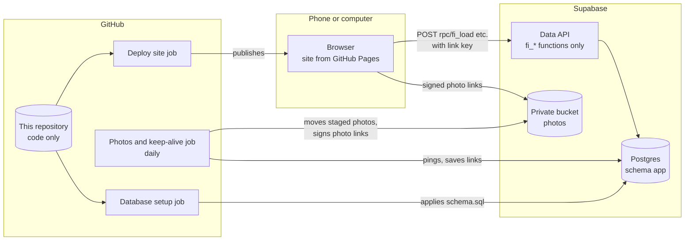

# How it fits together

## The parts

| Part | Where | What it does |
| --- | --- | --- |
| Website | `index.html`, `src/` | One page app. `src/main.js` draws every screen; `src/api.js` talks to Supabase; `src/style.css` is the look. |
| Database schema | `supabase/schema.sql` | Tables, the results view, and every function the site may call. Safe to re-run. |
| Photo job | `scripts/photos.mjs` | Moves newly staged photos into private storage and refreshes signed photo links. |
| Connection helper | `scripts/pg-env.sh` | Finds a working Postgres address for GitHub's runners (direct host, then session poolers). |
| GitHub Actions | `.github/workflows/` | `deploy.yml` (site), `database.yml` (schema), `photos.yml` (photos and keep-alive), `check.yml` (build check on pull requests). |
| Docs | `docs/` | These guides. |

## What happens when someone opens their link

1. The link is `https://pockelmann1.github.io/family-inventory/?k=<key>` (older
   links use `#k=<key>`; both work).
2. `start()` in `src/main.js` reads the key from the address, calls
   `fi_load(key)`, and, if the server accepts it, keeps the key in the address
   as `?k=` and in the browser's storage. Keeping it in the address means a
   bookmark, a Home Screen icon, or "Open in Safari" from inside Gmail or
   Facebook still works.
3. `fi_load` checks the SHA-256 hash of the key against `app.people`, then
   returns everything the screens need in one response: the person, families,
   items with ranks, results, signed photo links, and (for editors) drafts.
4. The browser draws the screen. Every later action is one more `fi_*` call
   with the same key: `fi_set_rank`, `fi_edit_item`, and so on.
5. If any call answers "invalid link" (the link was turned off or replaced),
   the site signs out at once and asks for the newest link.

## Screens

| Address | Screen | Who sees it |
| --- | --- | --- |
| `#/` | Browse: the collection, filters, rank buttons | everyone |
| `#/item/ITEM-0001` | One item: photos, ranking, details, own family's ranks, edit history | everyone |
| `#/family` | My family: your top 10 (drag to reorder, add from a search of what you ranked), the family top 10 (worked out from everyone's lists: 10 points for 1st place down to 1 for 10th, added up) and each person's top 10 side by side, then each family member's ranks | family members |
| `#/assign` | Assign: close ranking, give each item to a family, push to families, push updates | admin |
| `#/results` | Results: each family's family top 10 side by side and every person's list, best rank and most-wanted family per item, CSV download | admin |
| `#/fill` | Add info: one item at a time, with photo-based suggestions | editors and admin |
| `#/admin` | Admin: links, editors, who has started | admin |

Family members only ever see their own family's ranks, so nobody ranks
against what other families chose. The database enforces this: `fi_load`
and `fi_set_rank` return only the caller's own family's ranks, with no
overall best or most-wanted family. Their family's ranks are on My family;
Browse and the item page show no "most wanted" line, interest filter or
most-wanted sort. Results (every family) is for the admin, who does not rank
and sees everything. In `src/main.js` this is `seesOthers()` and the admin
check on the Results tab.

## Ranking, assigning and pushing

1. **Ranking open.** Family members rank and keep their top 10s.
2. **Ranking closed.** The admin closes ranking on Assign. Ranks and top 10s are
   kept but can't change (the database refuses), and families see a notice.
3. **Draft.** Each item starts with the family that ranked it best (a dashed
   button). The admin confirms it or taps another family, one item at a time.
   Ties and items nobody ranked wait for the admin. A count per family runs at
   the top. Families see nothing yet.
4. **Pushed.** "Push to families" stays locked until every visible item has a
   family. After the push every item shows where it went (Browse, item page,
   My family), and ranking can't reopen. Later changes are marked on their rows
   and stay a draft until "Push update" (or "Discard").

## Security in one paragraph

All tables sit in schema `app`, which the Supabase Data API does not expose,
with row-level security forced on and no table grants to the public roles. The
browser can only call `public.fi_*` functions. Each one is `security definer`
with an empty `search_path`, and the first thing it does is check the link key
(`app.person_for`), the admin flag (`app.admin_for`) or the editor flag
(`app.editor_for`). Photos are in a private bucket and reach the browser only
through signed links that expire after 3 days. The page sends no referrer and
has a content security policy that only allows this site's own scripts and the
family's Supabase project.
