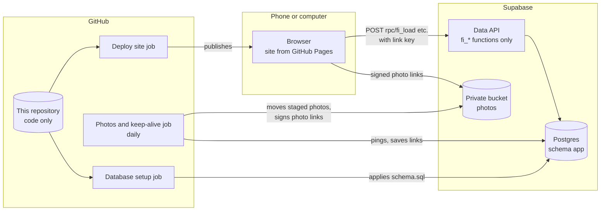

# How it fits together

## The parts

| Part | Where | What it does |
| --- | --- | --- |
| Website | `index.html`, `src/` | One page app. `src/main.js` draws every screen; `src/api.js` talks to Supabase; `src/style.css` is the look. |
| Database schema | `supabase/schema.sql` | Tables, the results view, and every function the site may call. Safe to re-run. |
| Photo job | `scripts/photos.mjs` | Moves newly staged photos into private storage and refreshes signed photo links. |
| Connection helper | `scripts/pg-env.sh` | Finds a working Postgres address for GitHub's runners (direct host, then session poolers). |
| GitHub Actions | `.github/workflows/` | `deploy.yml` (site), `database.yml` (schema), `photos.yml` (photos and keep-alive), `check.yml` (build check on pull requests). |
| Docs | `docs/` | These guides. |

## What happens when someone opens their link

1. The link is `https://pockelmann1.github.io/family-inventory/?k=<key>` (older
   links use `#k=<key>`; both work).
2. `start()` in `src/main.js` reads the key from the address, calls
   `fi_load(key)`, and, if the server accepts it, keeps the key in the address
   as `?k=` and in the browser's storage. Keeping it in the address means a
   bookmark, a Home Screen icon, or "Open in Safari" from inside Gmail or
   Facebook still works.
3. `fi_load` checks the SHA-256 hash of the key against `app.people`, then
   returns everything the screens need in one response: the person, families,
   items with ranks, results, signed photo links, and (for editors) drafts.
4. The browser draws the screen. Every later action is one more `fi_*` call
   with the same key: `fi_set_rank`, `fi_edit_item`, and so on.
5. If any call answers "invalid link" (the link was turned off or replaced),
   the site signs out at once and asks for the newest link.

## Screens

| Address | Screen | Who sees it |
| --- | --- | --- |
| `#/` | Browse: the collection, filters, rank buttons | everyone |
| `#/item/ITEM-0001` | One item: photos, ranking, details, own family's ranks, edit history | everyone |
| `#/family` | My family: each family member's ranks | family members |
| `#/results` | Results: best rank and most-wanted family per item, CSV download for admin | everyone |
| `#/fill` | Add info: one item at a time, with photo-based suggestions | editors and admin |
| `#/admin` | Admin: links, editors, who has started | admin |

People who rank do not see other families' ranks on Browse or the item page
(no "most wanted" line, interest filter or most-wanted sort), so they are
not swayed by them. They see them on My family (their own family) and
Results. The admin, who does not rank, sees everything everywhere. This is
the `seesOthers()` check in `src/main.js`.

## Security in one paragraph

All tables sit in schema `app`, which the Supabase Data API does not expose,
with row-level security forced on and no table grants to the public roles. The
browser can only call `public.fi_*` functions. Each one is `security definer`
with an empty `search_path`, and the first thing it does is check the link key
(`app.person_for`), the admin flag (`app.admin_for`) or the editor flag
(`app.editor_for`). Photos are in a private bucket and reach the browser only
through signed links that expire after 3 days. The page sends no referrer and
has a content security policy that only allows this site's own scripts and the
family's Supabase project.
